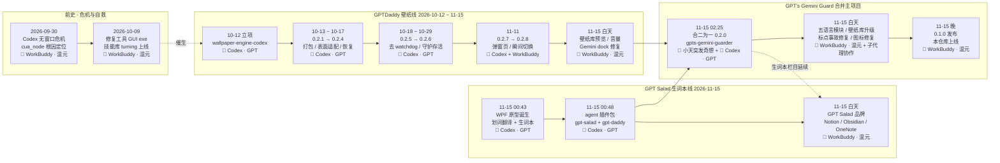

<div align="center">


# GPT's Gemini Guard

**壁纸 · 划词翻译 · 生词本 · 面板内真实 Gemini——官方 Codex Windows 桌面端的全能伴侣**

   

</div>

---

## 一个深夜的突发奇想

2026 年 11 月 14 日的深夜，一切都和往常一样：GPTDaddy 在 Codex 桌面端的后台稳定地循环着壁纸，GPT Salad——一个几个小时前才刚出生的划词翻译与生词本原型——还没来得及拥有自己的第一个正式版本。

就在那个晚上，一个念头突然冒了出来：**为什么不把两个插件合二为一？**

这个想法并非无中生有。Google 当年把内部的两大 AI 团队合并为一体，随后以「Gemini」命名其倾尽全力的大模型家族——合并且更名，本身就是一次向外的宣告：旧的时代结束了，新的东西诞生了。这里的情况如出一辙：GPTDaddy（壁纸与界面增强）和 GPT Salad（翻译与生词本）各自解决 Codex 桌面端的一块痛点，但用户真正想要的是一个整体。于是新项目被命名为——

> **GPT's Gemini Guard**：GPT 的「Gemini 卫士」。

名字定了，图标也就顺理成章地用上了 Gemini 的四角星。这不只是审美选择，而是三层深思熟虑：

1. **防止侵权**：与其在 GPT 生态的命名边缘试探，不如旗帜鲜明地把自己定位为「Gemini 的插件」，身份清晰，边界清晰。
2. **为日后用 Gemini 修改提示词铺路**：面板的 Gemini 栏内嵌的是 Chrome 打开的真实 Gemini 网页，沿用浏览器登录状态——把「改提示词」这件事随时放在手边。
3. **应对 OpenAI 的额度危机**：OpenAI 把 Chat 模式的额度合并进了 Codex，轻量任务再全部塞给 GPT 就太奢侈了。让插件真正成为 Gemini 的插件，翻译、润色、生词整理这类小活儿就可以分流给 Gemini 去干，把宝贵的 Codex 额度留给真正重要的工作。

当天凌晨 02:25，合并版本落地：旧的两个插件与旧市场入口移除，`gpts-gemini-guarder` 上线。第二天白天，五语言即时切换、壁纸库左侧预览与音量滑条、Gemini 入口图标与任务栏窗口行为等一轮密集增强接连落地。当晚，**GPT's Gemini Guard 0.1.0** 正式发布——这就是你现在看到的仓库。

---

## 演进流程图

三条产品线的完整设计流程、更新历程、节点时间，以及每一步背后干活的 agent 和模型：



> agent 与模型说明：🤖 Codex agent 运行 OpenAI GPT 系列模型（codex-cli 0.16x～0.167），承担了主项目绝大部分源码开发；🤖 WorkBuddy agent 运行腾讯混元系列模型，负责危机修复、面板增强、多语言与验收，并通过 codex-liaison / codex-watch 等子代理与 Codex 保持只读协作、互不覆盖；👤 小天（Twinight Miner）为唯一产品决策者与验收人。历史日志未逐条记录具体模型版本号，以上按平台如实标注。

---

## 当前能力（0.1.0）

- **Gemini 栏**：面板内嵌 Chrome 打开的真实 Gemini 网页，沿用浏览器登录状态，不依赖收费 API；停靠、拖出、全屏状态经 Win32 精确管理，绝不生成任务栏图标
- **壁纸引擎**：发现并导入 Wallpaper Engine 项目与本地媒体，CDP 注入 Codex 主页面，媒体缓存带来「瞬间切换」，冻结检测 + 有界恢复
- **壁纸库**：47 项全量可用，每张卡片左侧缩略图预览（图片自动展示、视频点击应用后播放），主题页音量滑条实时生效
- **划词翻译与生词本**：选中文本即弹「划词翻译 / 加入生词本 / 复制 / 搜索」菜单；词条存为用户自有 UTF-8 JSON，可导出 CSV/JSON，并接入 Notion / Obsidian / OneNote 三个入口
- **五语言界面**：跟随 Codex 语言或自定义（简体/繁體/English/日本語/한국어），单遍重写实测 0.7～1.5ms，零延迟零卡顿
- **安全边界**：不修改官方程序文件、不替换官方快捷方式、不重启 Codex 进程；全部设置持久于 `%LOCALAPPDATA%\GPTDaddy`

## 分支导航

| 分支 | 内容 |
|---|---|
| `main` | **GPT's Gemini Guard** 主项目（本页）：合并后完整源码、runtime 产物与 marketplace 插件包 |
| [`gptdaddy`](../gptdaddy/) | GPTDaddy 历史路线：0.1.0～0.2.8 源码与历代安装包/便携包产物归档 |
| [`gpt-salad`](../gpt-salad/) | GPT Salad 历史路线：WPF 桌面原型与 agent 插件包 |

## 运行

```powershell
npm test          # 30/30 通过
npm run doctor
npm start         # daemon 打印带随机 token 的本地控制面板 URL
```

Windows 打包：`npm ci` → `scripts/build-windows.ps1` → `scripts/package-portable.ps1` → `scripts/build-installer.ps1`（需 Inno Setup 6；本地视频导入需 `ffmpeg`/`ffprobe` 在 PATH）。`dist/runtime-v0.2.1/` 内含可直接部署的运行时产物（`node.exe` 属 Node.js 官方发行物，请自备 Node >= 22）。

Codex 进程需要已验证的本机 CDP 连接才会显示注入式菜单与悬浮面板；Gemini 栏需要 Chrome 与用户的 Gemini 网页登录状态。

## 许可证与致谢

AGPL-3.0-or-later，见 `LICENSE` 与 `THIRD_PARTY_NOTICES.md`。

- [WorkDaddy](https://github.com/babygoton/WorkDaddy)（AGPL-3.0-or-later）
- [dsh-plugin-wallpaper-engine-codex](https://github.com/JonathandNidhog/dsh-plugin-wallpaper-engine-codex)（MIT）

本项目独立于上述仓库、OpenAI 与 Google。Gemini 名称与图标仅用于互操作与致敬性描述，相关商标归其各自所有者。
