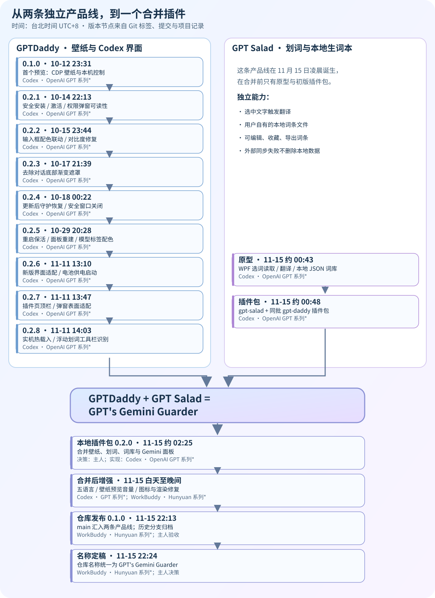

<div align="center">


# GPT's Gemini Guarder

**壁纸 · 划词翻译 · 生词本 · 面板内真实 Gemini——官方 Codex Windows 桌面端的全能伴侣**

   

</div>

### GPTDaddy + GPT Salad = GPT's Gemini Guarder

<table align="center">
<tr>
<td align="center"><br><strong>GPTDaddy</strong><br>壁纸与界面增强</td>
<td align="center"><strong>＋</strong></td>
<td align="center"><br><strong>GPT Salad</strong><br>划词翻译与本地生词本</td>
<td align="center"><strong>＝</strong></td>
<td align="center"><br><strong>GPT's Gemini Guarder</strong><br>合并后的插件</td>
</tr>
</table>

GPTDaddy 使用原先的黑底白色四芒星图标；合并插件使用独立图标。

---

## 一个深夜的突发奇想

2026 年 11 月 14 日深夜至 15 日凌晨，GPTDaddy 已能在 Codex 桌面端循环壁纸；GPT Salad 则刚以划词翻译与生词本原型出现，还没来得及拥有自己的第一个正式版本。

就在那个晚上，一个念头突然冒了出来：**为什么不把两个插件合二为一？**

这个想法并非无中生有。Google 当年把内部的两大 AI 团队合并为一体，随后以 Gemini 命名其倾尽全力的大模型家族——合并且更名，本身就是一次向外的宣告：旧的时代结束了，新的东西诞生了。这里的情况如出一辙：GPTDaddy（壁纸与界面增强）和 GPT Salad（划词翻译与生词本）各自解决 Codex 桌面端的一块痛点，但用户真正想要的从来就是一个整体。于是新项目被命名为——

> **GPT's Gemini Guarder**

名字定了，图标也就顺理成章地用上了 Gemini 的四角星。可这一笔落下，主人立刻意识到一个更现实的问题：**用 Gemini 的名字、用 Gemini 的图标，是有被 Google 追究商标与版权侵权的风险的。**

风险最高的，恰恰是那种「挂着 Gemini 图标、跟 Gemini 本身却毫无关系」的擦边插件——名字像、图标像、功能却跟 Gemini 半点关系没有，那才是标准的侵权姿态。所以真正的解法不是把名字改回去，而是**让它真的成为 Gemini 的插件**：

- 面板的 Gemini 栏里，嵌进去的就是 Chrome 打开的**真实 Gemini 网页**，沿用浏览器登录状态；
- 划词翻译、润色提示词、整理生词这类轻量活儿，真的由 Gemini 接手去做，而不是换个皮；
- 于是 "Gemini" 在这个名字里是**描述性的、互操作性的**——它如实说明了自己是什么，而不是冒用什么。名字、图标、功能三者终于对得上，风险反而降到了最低。

这一步，比"换个好听的名字"重要得多。名字定了、图标定、故事也就此展开：

1. **防止侵权**：让插件真正成为 Gemini 的插件，Gemini 一词便从"冒用"变成"如实描述"，把 Google 追究商标侵权的风险挡在门外。
2. **为日后用 Gemini 修改提示词铺路**：面板里随时就能打开真实 Gemini，把"改提示词"这件事放在手边，不用切窗口、不用重新登录。
3. **应对 OpenAI 的额度危机**：OpenAI 把 Chat 模式的额度合并进了 Codex，轻量任务再全部塞给 GPT 就太奢侈了。翻译、润色、生词整理交给 Gemini，把宝贵的 Codex 额度留给真正重要的工作。

11 月 15 日约 02:25，本地插件包合并为 `gpts-gemini-guarder`，其清单版本为 **0.2.0**。同一天白天至晚间，五语言即时切换、壁纸库左侧预览与音量滑条、Gemini 入口图标与窗口行为等增强陆续落地。22:13，本仓库的首个合并发布提交为 **0.1.0**；22:24，名称统一为 **GPT's Gemini Guarder**。本地插件包与仓库发布使用不同版本号。

---

## 演进流程图

两条独立产品线汇合为新插件的设计与版本历程，包含更新时间和可追溯的 agent／模型系列：

<a href="docs/evolution-map.svg"></a>

[点击查看 1200 × 1650 像素完整流程图](docs/evolution-map.svg)

图中的 **GPTDaddy 0.1.0～0.2.8** 时间来自[版本标签](https://github.com/twinightminer-arch/GPTs-Gemini-Guarder/tags)；功能来自对应提交与 `docs/` 实机审计。**GPT Salad** 的 00:43、00:48 与本地合并的 02:25 为原项目会话中的约略时间；独立路线于 11 月 15 日 22:09 归档到 `gpt-salad` 分支。**Guarder 0.2.0** 是本地市场插件清单版本，**0.1.0** 是 22:13 的仓库发布版本，两者不是同一套版本序列。

WorkBuddy 的 GPTDaddy 相关贡献已按旧版流程图补回：9 月 30 日的 Codex 无窗口问题定位、10 月 9 日的修复工具与技能、11 月 11 日 0.2.7～0.2.8 阶段的共同工作，以及合并后 11 月 15 日白天的壁纸库预览、音量与 Gemini dock 修复。最后一项发生在合并之后，因此画在 Guarder 的“Daddy 能力续建”节点。

> **agent 与模型说明：** 👤主人（Twinight_Miner）是产品决策者与验收人；Codex 使用 OpenAI GPT 系列模型，WorkBuddy 使用腾讯 Hunyuan 系列模型。图中的 agent 归属依据原项目说明与工作记录；Git 提交作者是仓库账号，不能单独证明执行该版本的 agent。历史记录未逐版本保留具体模型型号，图中以“系列*”标注，不臆造型号。

---

## 当前能力（0.1.0）

- **Gemini 栏**：面板内嵌 Chrome 打开的真实 Gemini 网页，沿用浏览器登录状态，不依赖收费 API；停靠、拖出、全屏状态经 Win32 精确管理，绝不生成任务栏图标
- **壁纸引擎**：发现并导入 Wallpaper Engine 项目与本地媒体，CDP 注入 Codex 主页面，媒体缓存带来「瞬间切换」，冻结检测 + 有界恢复
- **壁纸库**：47 项全量可用，每张卡片左侧缩略图预览（图片自动展示、视频点击应用后播放），主题页音量滑条实时生效
- **GPT Salad 生词本**：选中文本即弹「划词翻译 / 加入生词本 / 复制 / 搜索」菜单；词条存为用户自有 UTF-8 JSON，可导出 CSV/JSON，并接入 Notion / Obsidian / OneNote 三个入口
- **五语言界面**：跟随 Codex 语言或自定义（简体/繁體/English/日本語/한국어），单遍重写实测 0.7～1.5ms，零延迟零卡顿
- **安全边界**：不修改官方程序文件、不替换官方快捷方式、不重启 Codex 进程；全部设置持久于 `%LOCALAPPDATA%\GPTDaddy`

## 分支导航

| 分支 | 内容 |
|---|---|
| `main` | **GPT's Gemini Guarder** 主项目（本页）：合并后完整源码、runtime 产物与 marketplace 插件包 |
| [`gptdaddy`](../gptdaddy/) | GPTDaddy 历史路线：0.1.0～0.2.8 源码与历代安装包/便携包产物归档 |
| [`gpt-salad`](../gpt-salad/) | GPT Salad 历史路线：WPF 桌面原型与 agent 插件包 |

## 运行

```powershell
npm test          # 30/30 通过
npm run doctor
npm start         # daemon 打印带随机 token 的本地控制面板 URL
```

Windows 打包：`npm ci` → `scripts/build-windows.ps1` → `scripts/package-portable.ps1` → `scripts/build-installer.ps1`（需 Inno Setup 6；本地视频导入需 `ffmpeg`/`ffprobe` 在 PATH）。`dist/runtime-v0.2.1/` 内含可直接部署的运行时产物（`node.exe` 属 Node.js 官方发行物，请自备 Node >= 22）。

Codex 进程需要已验证的本机 CDP 连接才会显示注入式菜单与悬浮面板；Gemini 栏需要 Chrome 与用户的 Gemini 网页登录状态。

## 许可证与致谢

AGPL-3.0-or-later，见 `LICENSE` 与 `THIRD_PARTY_NOTICES.md`。

- [WorkDaddy](https://github.com/babygoton/WorkDaddy)（AGPL-3.0-or-later）
- [dsh-plugin-wallpaper-engine-codex](https://github.com/JonathandNidhog/dsh-plugin-wallpaper-engine-codex)（MIT）

本项目独立于上述仓库、OpenAI 与 Google，并非 Google 或 OpenAI 的官方产品。Gemini 名称与图标用于如实标识本插件与 Gemini 之间的真实互操作关系，属描述性与致敬性使用，相关商标归其各自所有者。
